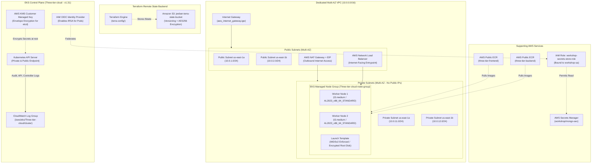
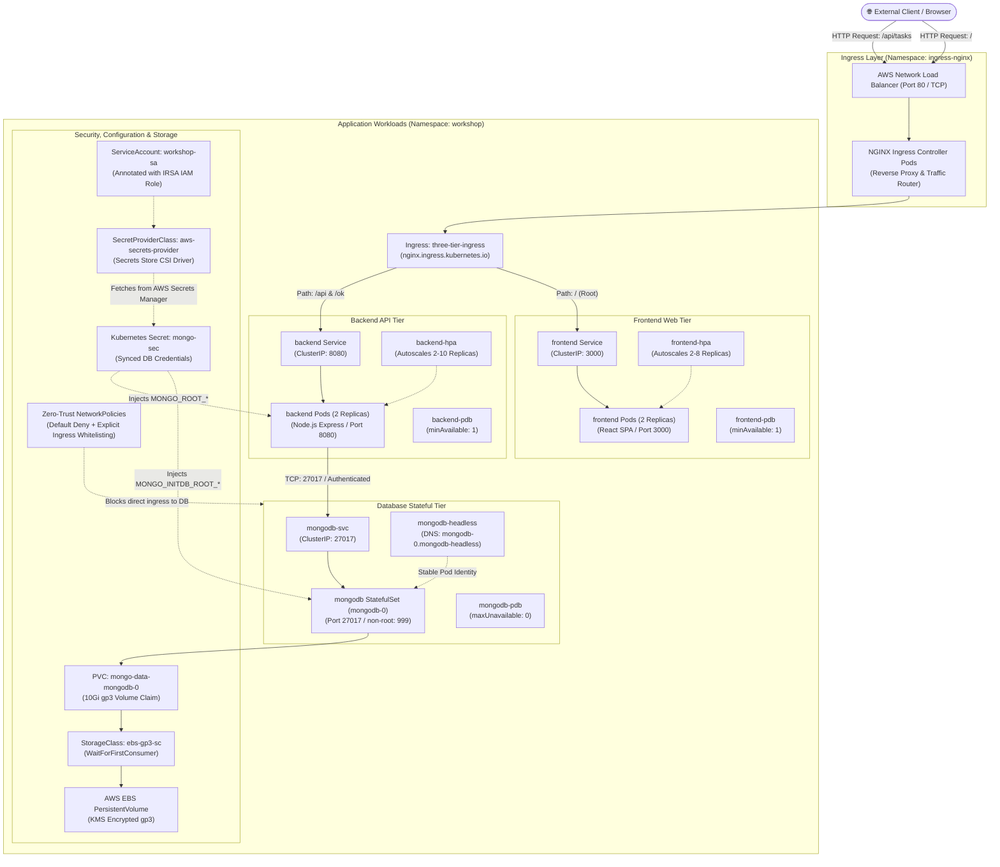

# 🚀 Production Three-Tier Application on AWS EKS

An enterprise-grade, end-to-end deployment guide for a **Three-Tier Web Application** (React Frontend + Node.js API + MongoDB Database) on **Amazon EKS** using **Terraform**, **Kubernetes StatefulSets**, **AWS EBS gp3 StorageClass**, **AWS Secrets Manager**, and **NGINX Ingress**.

> **Target Audience**: Designed for Software Developers (SDEs), QA/SDET Engineers, and DevOps Engineers. No prior advanced Kubernetes or AWS administration experience is required—every step includes copy-paste commands and clear explanations.

---

## 📑 Table of Contents
1. [Architecture Overview](#-architecture-overview)
   - [High-Level End-to-End System Architecture](#high-level-end-to-end-system-architecture)
   - [1. Terraform & AWS Cloud Infrastructure Diagram](#1-terraform--aws-cloud-infrastructure-diagram)
   - [2. Kubernetes Workloads & Request Traffic Flow Diagram](#2-kubernetes-workloads--request-traffic-flow-diagram)
2. [Prerequisites & Tooling Installation](#-prerequisites--tooling-installation)
3. [Repository Structure](#-repository-structure)
4. [Step-by-Step Deployment Guide](#-step-by-step-deployment-guide)
   - [Phase 1: AWS Account & S3 State Bucket](#phase-1-aws-account--s3-state-bucket)
   - [Phase 2: Provision Infrastructure with Terraform](#phase-2-provision-infrastructure-with-terraform)
   - [Phase 3: Connect to EKS Cluster](#phase-3-connect-to-eks-cluster)
   - [Phase 4: Build & Push Docker Images to ECR](#phase-4-build--push-docker-images-to-ecr)
   - [Phase 5: Install Cluster Ingress & Secrets Controllers](#phase-5-install-cluster-ingress--secrets-controllers)
   - [Phase 6: Deploy Kubernetes Application Workloads](#phase-6-deploy-kubernetes-application-workloads)
5. [Verification & Testing (QA / SDE Guide)](#-verification--testing-qa--sde-guide)
6. [Common Troubleshooting & Gotchas](#-common-troubleshooting--gotchas)
7. [Tear Down & Clean Up (Cost Control)](#-tear-down--clean-up-cost-control)

---

## 🏗️ Architecture Overview

The system architecture is structured into two decoupled, enterprise-grade layers:
1. **Infrastructure as Code (Terraform)**: Provisions the foundational AWS networking, KMS security, IAM roles, ECR registries, and the managed EKS cluster across multiple Availability Zones.
2. **Container Workload Orchestration (Kubernetes)**: Runs the three-tier application, automated routing, data persistence, and security controls inside the EKS cluster.

---

### High-Level End-to-End System Architecture

```text
                                  🌐 INTERNET (Users / QA Testers)
                                                 │
                                     ┌───────────▼───────────┐
                                     │  Internet Gateway     │
                                     └───────────┬───────────┘
                                                 │
                              ┌──────────────────┴──────────────────┐
                              │    PUBLIC SUBNETS (Multi-AZ)        │
                              │  ┌───────────────────────────────┐  │
                              │  │  AWS Network Load Balancer    │  │
                              │  │  (Managed by NGINX Ingress)   │  │
                              │  └───────────────┬───────────────┘  │
                              │  ┌───────────────▼───────────────┐  │
                              │  │       NAT Gateway (EIP)       │  │
                              │  └───────────────┬───────────────┘  │
                              └──────────────────┼──────────────────┘
                                                 │
                              ┌──────────────────▼──────────────────┐
                              │    PRIVATE SUBNETS (Multi-AZ)       │
                              │    (No Direct Internet Ingress)     │
                              │                                     │
                              │  ┌───────────────────────────────┐  │
                              │  │  EKS Managed Worker Nodes     │  │
                              │  │  (KMS Encrypted gp3, IMDSv2)  │  │
                              │  └───────────────┬───────────────┘  │
                              │                  │                  │
                              │      ┌───────────┴───────────┐      │
                              │      │                       │      │
                              │  ┌───▼───────────┐       ┌───▼───┐  │
                              │  │ React Frontend│       │Backend│  │
                              │  │ (Port 3000)   │       │  API  │  │
                              │  └───┬───────────┘       └───┬───┘  │
                              │      │ (via Ingress)         │      │
                              │      └───────────────────────┤      │
                              │                              │      │
                              │                     ┌────────▼───┐  │
                              │                     │  MongoDB   │  │
                              │                     │StatefulSet │  │
                              │                     └────────┬───┘  │
                              │                              │      │
                              │                     ┌────────▼───┐  │
                              │                     │ EBS gp3 PV │  │
                              │                     │ (KMS Enc.) │  │
                              │                     └────────────┘  │
                              └─────────────────────────────────────┘
```

---

### 1. Terraform & AWS Cloud Infrastructure Diagram

The following diagram illustrates every AWS cloud resource provisioned by Terraform in [`terra-config/`](file:///c:/Users/deepa/Downloads/3-tier-app-Deployment/terra-config/):



#### Key Infrastructure Highlights:
- **Zero Public IPs on Nodes**: All EC2 worker nodes and application containers run in private subnets across two Availability Zones (`us-east-1a` & `us-east-1b`).
- **Secure Outbound Access**: Nodes access external APIs and image registries strictly via a managed NAT Gateway and Elastic IP.
- **KMS Envelope Encryption**: All Kubernetes Secret objects are encrypted before being written to `etcd` using an AWS KMS Customer Managed Key.
- **IMDSv2 Enforced**: Protects against SSRF vulnerabilities by requiring session tokens for EC2 instance metadata access.

---

### 2. Kubernetes Workloads & Request Traffic Flow Diagram

The following diagram details all container workloads, internal services, storage, and zero-trust policies inside the **`workshop`** Kubernetes namespace:



#### Key Kubernetes Flow Highlights:
1. **Edge Routing**: All incoming HTTP traffic hits the AWS NLB, which delegates to the NGINX Ingress Controller. The Ingress forwards requests to `/` to the React frontend and `/api` or `/ok` to the Node.js backend API.
2. **Dynamic Stateful Storage**: MongoDB runs as a `StatefulSet` with an automated PersistentVolumeClaim (`mongo-data-mongodb-0`). The AWS EBS CSI driver dynamically provisions a 10Gi encrypted EBS `gp3` disk upon scheduling (`WaitForFirstConsumer`).
3. **Automated Secret Syncing**: The Secrets Store CSI Driver connects the Kubernetes `ServiceAccount` to AWS Secrets Manager using IAM Roles for Service Accounts (IRSA). Credentials are automatically synchronized to the Kubernetes Secret `mongo-sec` and injected as environment variables.
4. **Zero-Trust Network Security**: A default-deny network policy ensures that external clients cannot connect directly to MongoDB, and only backend pods are authorized to communicate with MongoDB over port 27017.

---

## 🛠️ Prerequisites & Tooling Installation

Before you begin, install the required CLI tools on your operating system.

### 1. Install CLI Tools

#### On Windows (PowerShell as Administrator or Git Bash):
```powershell
# Using winget (recommended):
winget install Amazon.AWSCLI
winget install Hashicorp.Terraform
winget install Kubernetes.kubectl
winget install Helm.Helm
winget install Docker.DockerDesktop
```

#### On macOS (Terminal):
```bash
brew install awscli terraform kubectl helm docker
```

#### On Linux (Debian/Ubuntu):
```bash
# AWS CLI v2
curl "https://awscli.amazonaws.com/awscli-exe-linux-x86_64.zip" -o "awscliv2.zip"
unzip awscliv2.zip && sudo ./aws/install

# Terraform
sudo apt-get update && sudo apt-get install -y gnupg software-properties-common curl
curl -fsSL https://apt.releases.hashicorp.com/gpg | sudo apt-key add -
sudo apt-add-repository "deb [arch=amd64] https://apt.releases.hashicorp.com $(lsb_release -cs) main"
sudo apt-get update && sudo apt-get install terraform

# kubectl & helm
sudo snap install kubectl --classic
sudo snap install helm --classic
```

### 2. Verify Installations
Run these verification commands in your terminal:
```bash
aws --version        # Should be aws-cli/2.x.x
terraform --version  # Should be >= v1.3.x
kubectl version --client
helm version
docker --version
```

### 3. Configure AWS Credentials
Ensure you have an AWS account with IAM permissions (AdministratorAccess or PowerUser):
```bash
aws configure
```
Enter your details:
- **AWS Access Key ID**: `YOUR_ACCESS_KEY`
- **AWS Secret Access Key**: `YOUR_SECRET_KEY`
- **Default region name**: `us-east-1`
- **Default output format**: `json`

Verify authentication:
```bash
aws sts get-caller-identity
```

---

## 📁 Repository Structure

```text
3-tier-app-Deployment/
├── backend/                             # Node.js Express API source code & Dockerfile
│   ├── Dockerfile                       # Builds backend image listening on port 8080
│   ├── index.js                         # Express routing and task controllers
│   └── db.js                            # MongoDB connection with authentication support
├── frontend/                            # React SPA source code & Dockerfile
│   ├── Dockerfile                       # Builds React UI container listening on port 3000
│   ├── src/                             # React application source code
│   └── package.json                     # Dependencies (react, react-scripts)
├── k8s_manifests/                       # Production Kubernetes YAML manifests
│   ├── 00-namespace.yaml                # Creates isolated 'workshop' namespace
│   ├── 01-storageclass.yaml             # Dynamic AWS EBS gp3 StorageClass (WaitForFirstConsumer)
│   ├── 02-serviceaccount.yaml           # ServiceAccount with AWS IAM role annotation (IRSA)
│   ├── 03-secret-provider-class.yaml    # Syncs AWS Secrets Manager to k8s Secret 'mongo-sec'
│   ├── 04-pod-disruption-budget.yaml    # Ensures high availability during maintenance
│   ├── 05-network-policy.yaml           # Zero-Trust network rules (DB isolated to Backend)
│   ├── 06-hpa.yaml                      # Horizontal Pod Autoscalers based on CPU/RAM
│   ├── 07-resource-quota.yaml           # Guardrail quotas preventing node resource exhaustion
│   ├── backend-deployment.yaml          # Backend API Deployment (HA replicas, health probes)
│   ├── backend-service.yaml             # Backend ClusterIP service on port 8080
│   ├── frontend-deployment.yaml         # Frontend React Deployment (HA replicas, 512Mi RAM)
│   ├── frontend-service.yaml            # Frontend ClusterIP service on port 3000
│   ├── ingress-nginx.yaml               # Ingress routing (/ to frontend, /api to backend)
│   └── mongo/                           # Database stateful workload
│       ├── statefulset.yaml             # MongoDB StatefulSet with dynamic 10Gi gp3 PVC
│       └── service.yaml                 # Dual headless & ClusterIP access services
└── terra-config/                        # Terraform Infrastructure as Code (IaC)
    ├── backend.tf                       # S3 remote state storage configuration
    ├── ecr.tf                           # AWS ECR public repositories for container images
    ├── eks.tf                           # EKS Cluster (Kubernetes 1.31) with CloudWatch logging
    ├── kms.tf                           # AWS KMS Customer Managed Key with annual rotation
    ├── node_group.tf                    # Worker Node Group (Amazon Linux 2023, IMDSv2 enforced)
    ├── outputs.tf                       # Exposed outputs (VPC, Subnets, ECR URLs, OIDC ARN)
    ├── provider.tf                      # AWS provider definition with project tags
    ├── role.tf                          # IAM Roles for cluster, nodes, and EBS CSI driver
    ├── secrets.tf                       # AWS Secrets Manager secret & IRSA IAM policy
    ├── security_groups.tf               # Least-privilege network firewalls
    ├── variables.tf                     # Configurable parameters (CIDRs, cluster names)
    └── vpc.tf                           # Dedicated multi-AZ VPC with NAT Gateway
```

---

## 🚀 Step-by-Step Deployment Guide

Follow these steps sequentially from top to bottom.

---

### Phase 1: AWS Account & S3 State Bucket

Terraform stores its state file in Amazon S3. Because S3 bucket names must be globally unique across all AWS accounts, choose a custom name or use the default configured in `terra-config/backend.tf`:

1. **Create the S3 bucket in AWS**:
   ```bash
   aws s3api create-bucket \
     --bucket jeeban-terra-state-bucket \
     --region us-east-1
   ```
   *(If using your own bucket name, also update line 3 of [`terra-config/backend.tf`](file:///c:/Users/deepa/Downloads/3-tier-app-Deployment/terra-config/backend.tf)).*

2. **Enable versioning and server-side encryption**:
   ```bash
   aws s3api put-bucket-versioning \
     --bucket jeeban-terra-state-bucket \
     --versioning-configuration Status=Enabled

   aws s3api put-bucket-encryption \
     --bucket jeeban-terra-state-bucket \
     --server-side-encryption-configuration '{"Rules":[{"ApplyServerSideEncryptionByDefault":{"SSEAlgorithm":"AES256"}}]}'
   ```

---

### Phase 2: Provision Infrastructure with Terraform

1. Open your terminal and navigate to the `terra-config/` directory:
   ```bash
   cd terra-config
   ```

2. Initialize Terraform (downloads AWS provider plugins and connects to S3):
   ```bash
   terraform init
   ```

3. Provision the entire infrastructure:
   ```bash
   terraform apply --auto-approve
   ```

> ⏱️ **Provisioning Time**: Takes approximately **12 to 15 minutes**. EKS provisions redundant AWS control plane nodes, sets up multi-AZ VPC networking, and bootstraps Amazon Linux 2023 EC2 worker nodes. Do not cancel the process.

4. Once it finishes (`Apply complete!`), view the outputs:
   ```bash
   terraform output
   ```

---

### Phase 3: Connect to EKS Cluster

1. Update your local `kubeconfig` to authenticate `kubectl` with the new EKS cluster:
   ```bash
   aws eks update-kubeconfig --region us-east-1 --name Three-tier-cloud
   ```

2. Verify that your worker nodes are online and in the `Ready` status:
   ```bash
   kubectl get nodes -o wide
   ```
   *Expected Output*:
   ```text
   NAME                          STATUS   ROLES    AGE   VERSION   OS-IMAGE
   ip-10-0-11-xxx.ec2.internal   Ready    <none>   5m    v1.31.x   Amazon Linux 2023
   ip-10-0-12-xxx.ec2.internal   Ready    <none>   5m    v1.31.x   Amazon Linux 2023
   ```

---

### Phase 4: Build & Push Docker Images to ECR

1. Return to the root directory:
   ```bash
   cd ..
   ```

2. Make sure **Docker Desktop** is running on your machine.

3. Authenticate Docker to AWS Public ECR:
   ```bash
   aws ecr-public get-login-password --region us-east-1 | docker login --username AWS --password-stdin public.ecr.aws
   ```
   ✅ *Expected Output*: `Login Succeeded`

4. Retrieve your exact ECR repository URLs:
   ```bash
   aws ecr-public describe-repositories --region us-east-1 --query "repositories[].[repositoryName,repositoryUri]" --output table
   ```
   *(Example: `public.ecr.aws/<YOUR-ALIAS>/three-tier-backend`)*

5. **Build and push the Backend container image**:
   ```bash
   docker build -t <YOUR_BACKEND_ECR_URI>:latest ./backend
   docker push <YOUR_BACKEND_ECR_URI>:latest
   ```

6. **Build and push the Frontend container image**:
   ```bash
   docker build -t <YOUR_FRONTEND_ECR_URI>:latest ./frontend
   docker push <YOUR_FRONTEND_ECR_URI>:latest
   ```

7. Update the container image tags in the Kubernetes manifests:
   - In [`k8s_manifests/backend-deployment.yaml`](file:///c:/Users/deepa/Downloads/3-tier-app-Deployment/k8s_manifests/backend-deployment.yaml#L99): Set `image: <YOUR_BACKEND_ECR_URI>:latest`
   - In [`k8s_manifests/frontend-deployment.yaml`](file:///c:/Users/deepa/Downloads/3-tier-app-Deployment/k8s_manifests/frontend-deployment.yaml#L92): Set `image: <YOUR_FRONTEND_ECR_URI>:latest`

---

### Phase 5: Install Cluster Ingress & Secrets Controllers

EKS requires two standard controllers installed via Helm:

#### 1. Install NGINX Ingress Controller
Creates the external AWS Network Load Balancer (NLB) in the public subnets:
```bash
helm repo add ingress-nginx https://kubernetes.github.io/ingress-nginx
helm repo update ingress-nginx

helm install ingress-nginx ingress-nginx/ingress-nginx \
  --namespace ingress-nginx --create-namespace \
  --set controller.service.annotations."service\.beta\.kubernetes\.io/aws-load-balancer-type"="nlb" \
  --set controller.service.annotations."service\.beta\.kubernetes\.io/aws-load-balancer-scheme"="internet-facing" \
  --set controller.admissionWebhooks.enabled=false
```

#### 2. Install AWS Secrets Store CSI Driver & Provider
Enables Kubernetes to retrieve database credentials securely from AWS Secrets Manager:
```bash
# Install Secrets Store CSI Driver
helm repo add secrets-store-csi-driver https://kubernetes.github.io/secrets-store-csi-driver/charts
helm repo update secrets-store-csi-driver

helm install csi-secrets-store secrets-store-csi-driver/secrets-store-csi-driver \
  --namespace kube-system \
  --set syncSecret.enabled=true \
  --set enableSecretRotation=true

# Install AWS Secrets and Configuration Provider (ASCP)
helm repo add aws-secrets-manager https://aws.github.io/secrets-store-csi-driver-provider-aws
helm repo update aws-secrets-manager

helm install secrets-provider-aws aws-secrets-manager/secrets-store-csi-driver-provider-aws \
  --namespace kube-system
```

Verify that controller pods are running:
```bash
kubectl get pods -n ingress-nginx
kubectl get pods -n kube-system -l "app.kubernetes.io/instance in (csi-secrets-store,secrets-provider-aws)"
```

---

### Phase 6: Deploy Kubernetes Application Workloads

Apply all Kubernetes manifests from the project root directory:

```bash
# 1. Base Setup: Namespace, StorageClass, ServiceAccount, SecretsProviderClass
kubectl apply -f k8s_manifests/00-namespace.yaml
kubectl apply -f k8s_manifests/01-storageclass.yaml
kubectl apply -f k8s_manifests/02-serviceaccount.yaml
kubectl apply -f k8s_manifests/03-secret-provider-class.yaml

# 2. Production Governance: PDBs, NetworkPolicies, HPAs, ResourceQuotas
kubectl apply -f k8s_manifests/04-pod-disruption-budget.yaml
kubectl apply -f k8s_manifests/05-network-policy.yaml
kubectl apply -f k8s_manifests/06-hpa.yaml
kubectl apply -f k8s_manifests/07-resource-quota.yaml

# 3. Deploy Stateful Database: MongoDB StatefulSet & Persistent Volumes
kubectl apply -f k8s_manifests/mongo/

# 4. Deploy Backend API
kubectl apply -f k8s_manifests/backend-service.yaml
kubectl apply -f k8s_manifests/backend-deployment.yaml

# 5. Deploy Frontend Web Application
kubectl apply -f k8s_manifests/frontend-service.yaml
kubectl apply -f k8s_manifests/frontend-deployment.yaml

# 6. Deploy NGINX Ingress Routing Rules
kubectl apply -f k8s_manifests/ingress-nginx.yaml
```

---

## 🧪 Verification & Testing (QA / SDE Guide)

### 1. Check Pod Health
```bash
kubectl get pods -n workshop
```
✅ **Expected Output**:
```text
NAME                        READY   STATUS    RESTARTS   AGE
backend-678679cbd8-5fnsp    1/1     Running   0          5m
backend-678679cbd8-r8gqb    1/1     Running   0          5m
frontend-68698b7df7-b4wjf   1/1     Running   0          5m
frontend-68698b7df7-s7vbw   1/1     Running   0          5m
mongodb-0                   1/1     Running   0          10m
```

### 2. Verify Persistent Storage
Verify that MongoDB has dynamically allocated and bound a 10Gi AWS EBS `gp3` volume:
```bash
kubectl get pvc -n workshop
```
✅ **Expected Output**:
```text
NAME                     STATUS   VOLUME                                     CAPACITY   ACCESS MODES   STORAGECLASS
mongo-data-mongodb-0     Bound    pvc-0018a098-xxxx-xxxx-xxxx-xxxxxxxxxxxx   10Gi       RWO            ebs-gp3-sc
```

### 3. Retrieve Application URL
Retrieve the external AWS Load Balancer DNS name:
```bash
kubectl get ingress three-tier-ingress -n workshop
```
Look at the **`ADDRESS`** column (e.g. `ac80189d42eac49369f41105393246e5-92b4b4a1a7d160f2.elb.us-east-1.amazonaws.com`).

### 4. End-to-End Application Testing

#### Test A: Frontend Web Interface
Open `http://<YOUR_INGRESS_ADDRESS>` in your browser:
1. The **TO-DO App** interface renders.
2. Type a task name (e.g. `Run automated sanity test`) and click **Add Task**.
3. Verify that the task appears in the list.

#### Test B: Backend API Verification
Test the REST API endpoints directly from your terminal:
```bash
# Health check endpoint
curl -i http://<YOUR_INGRESS_ADDRESS>/ok

# Fetch all tasks from MongoDB
curl -i http://<YOUR_INGRESS_ADDRESS>/api/tasks
```
✅ Both should return `HTTP/1.1 200 OK`.

#### Test C: Data Persistence Test (StatefulSet Guarantee)
1. Delete the MongoDB pod to simulate an unexpected node failure or restart:
   ```bash
   kubectl delete pod mongodb-0 -n workshop
   ```
2. Kubernetes will automatically recreate `mongodb-0` and re-attach the existing EBS volume.
3. Refresh your browser: **All your tasks are still intact!**

---

## 💡 Common Troubleshooting & Gotchas

### 1. Docker Login: `The stub received bad data`
- **Symptom**: `docker login public.ecr.aws` fails with `error storing credentials - err: exit status 1, out: The stub received bad data.`
- **Cause**: Windows Credential Manager has a 512-byte limit that cannot store long AWS ECR tokens.
- **Fix**: Open `%USERPROFILE%\.docker\config.json` in a text editor, delete the `"credsStore": "desktop"` line, save the file, and run `docker login` again.

### 2. Ingress Admission Webhook Timeout
- **Symptom**: `failed calling webhook "validate.nginx.ingress.kubernetes.io": context deadline exceeded`
- **Fix**: Delete the non-critical admission validating webhook:
  ```bash
  kubectl delete validatingwebhookconfiguration ingress-nginx-admission
  ```

### 3. Frontend Error: `EACCES: permission denied, mkdir '/usr/src/app/node_modules/.cache'`
- **Symptom**: React displays a red compilation overlay with `EACCES: permission denied`.
- **Cause**: `react-scripts` running under UID `1000` attempting to write to root-owned `/usr/src/app/node_modules/.cache`.
- **Fix**: In [`k8s_manifests/frontend-deployment.yaml`](file:///c:/Users/deepa/Downloads/3-tier-app-Deployment/k8s_manifests/frontend-deployment.yaml), remove `runAsUser: 1000` and `runAsNonRoot: true` from the pod's `securityContext`, then re-apply the manifest.

### 4. Pod Crashes with `OOMKilled` (Exit Code 137)
- **Symptom**: Frontend pod restarts repeatedly with status `CrashLoopBackOff` or `OOMKilled`.
- **Cause**: Webpack development server requires ~350MB–500MB of RAM during compilation.
- **Fix**: Ensure `resources.limits.memory` is set to at least `512Mi` in [`k8s_manifests/frontend-deployment.yaml`](file:///c:/Users/deepa/Downloads/3-tier-app-Deployment/k8s_manifests/frontend-deployment.yaml).

---

## 🧹 Tear Down & Clean Up (Cost Control)

To completely delete all AWS resources and prevent recurring cloud charges:

```bash
# 1. Delete Kubernetes resources (deallocates AWS Network Load Balancer and EBS volumes)
kubectl delete -f k8s_manifests/ingress-nginx.yaml
kubectl delete -f k8s_manifests/ -f k8s_manifests/mongo/

# 2. Uninstall Helm charts
helm uninstall ingress-nginx -n ingress-nginx
helm uninstall csi-secrets-store -n kube-system
helm uninstall secrets-provider-aws -n kube-system

# 3. Destroy Terraform cloud infrastructure (VPC, EKS cluster, worker nodes, KMS key)
cd terra-config/
terraform destroy --auto-approve

# 4. Clean up S3 Remote State Bucket
cd ..
aws s3 rm s3://jeeban-terra-state-bucket --recursive
aws s3api delete-bucket --bucket jeeban-terra-state-bucket --region us-east-1
```